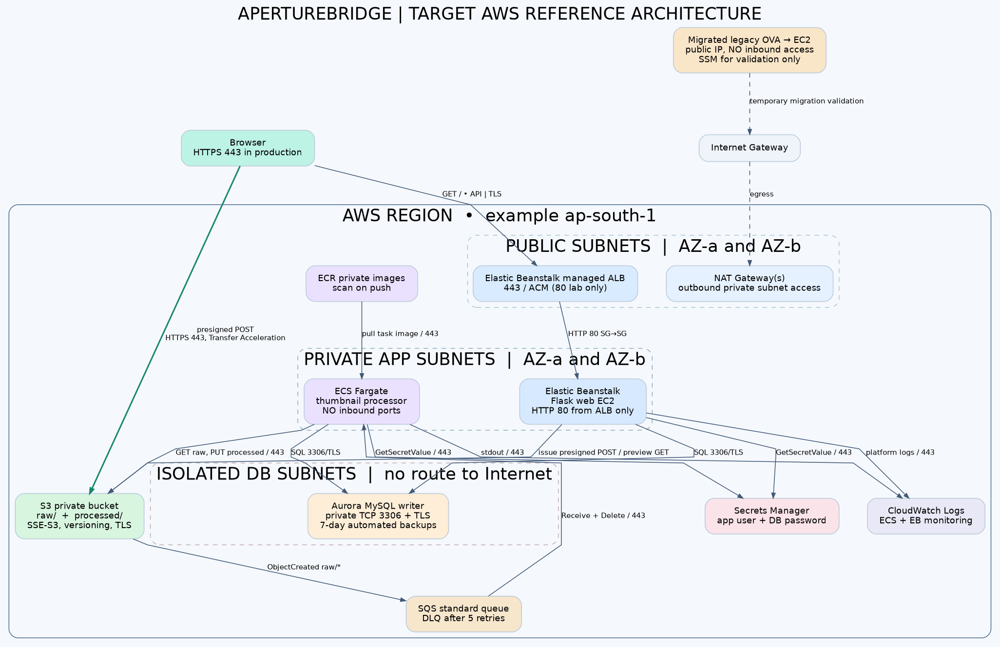

# ApertureBridge | AWS Application Migration Blueprint

> **Case:** Company ABC, a single-server image-hosting platform → a segmented AWS application with independent web, processing and database tiers.
>
> **Delivery:** original architecture diagrams, a functional demonstration application, Terraform, container build, migration utilities, Windows PowerShell runbooks, local integration stack and GitHub Actions validation.
>
> **Status:** complete reference implementation; **not an AWS-deployed project**. Cloud deployment, real OVA conversion, MySQL data migration and account-specific verification require credentials and source assets that were not supplied.



## 1. The assignment and how this implementation addresses it

The supplied training brief has two phases. The original server hosts a website, backend processor, MySQL and images on the same machine. The PDF supplies **no application source code, VM/OVA, legacy MySQL schema, image archive, AWS account or domain name**. Therefore, this repository builds a clearly labeled **representative implementation** of those components. It does not claim to have migrated any actual ABC customer data.

| Assignment requirement | Where implemented | What still needs real input |
|---|---|---|
| Phase 1: containerize backend | `worker/Dockerfile`, `worker/processor.py` | Replace reference processing rules if legacy behavior differs |
| Phase 1: frontend uploads to S3 | `frontend/application.py`: short-lived presigned POST, 10 MiB limit | Configure final HTTPS domain and S3 CORS |
| Phase 1: export full system as OVA | `docs/MIGRATION_RUNBOOK.md`: verified export checklist | Source VM/hypervisor and its data |
| Phase 2: import OVA as EC2 VM with public IP | `scripts/06-Import-LegacyVM.ps1`, VM Import IAM, public subnet | Actual compatible OVA and OS license |
| Phase 2: host frontend on Elastic Beanstalk | `terraform/beanstalk.tf`, `scripts/05-Publish-Frontend.ps1` | AWS deployment approval and DNS/certificate for HTTPS |
| Phase 2: MySQL → Aurora MySQL | `terraform/database.tf`, `docs/MIGRATION_RUNBOOK.md` | Source schema, source privileges, DMS/source connectivity |
| Phase 2: backend → ECR and ECS | `terraform/compute.tf`, `scripts/03-Publish-Worker.ps1` | AWS deployment, image publish, desired count 1 |
| Phase 2: historical images → S3 using Transfer Acceleration | `terraform/storage.tf`, `scripts/07-Backfill-Legacy.py` | Image inventory and CSV mapping; VPC-connected execution |

### Deliberate design choices

- A **private S3 bucket** stores original images under `raw/` and JPEG previews under `processed/`. The browser uses a **presigned POST** instead of sending image bytes through EC2, removing a substantial bandwidth bottleneck.
- S3 object-created events go to **SQS Standard**; private **ECS Fargate** workers consume them and update metadata in Aurora. The queue, visibility timeout, idempotent object key and dead-letter queue avoid treating an upload as an immediate synchronous success.
- **Aurora MySQL** is private. The web and worker use an application SQL user; a **separate one-off ECS task** initializes the schema using the Aurora-managed administrative secret.
- A migrated legacy EC2 VM receives a **public IP** as requested, but its security group has **zero inbound access**. Diagnostics use **Session Manager**. This VM is a temporary validation bridge, not the future production web tier.
- Terraform defaults are explicitly an **expensive demonstration / lab configuration**, not a production security/compliance attestation. A real production rollout requires HTTPS, authentication, WAF/rate limits, multi-AZ instances, stronger monitoring, migration rehearsal and controlled cutover.

## 2. Repository map

```text
ApertureBridge_AWS_Migration_Project/
├── diagrams/               4 editable Graphviz .dot blueprints + SVG/PNG renders
├── terraform/              network, Aurora, IAM, S3, SQS, ECR, ECS, Beanstalk
├── frontend/               Flask website, HTML/CSS/JS, production Procfile
├── worker/                 Fargate image processor + privileged schema task
├── shared/                 common database schema and cloud clients
├── local/                  Docker Compose: MySQL + LocalStack + web + worker
├── scripts/                numbered PowerShell operator steps + legacy backfill
├── sql/                    legacy MySQL preflight and source mapping example
├── tests/                  unit/integration scenarios using moto + SQLite
├── docs/                   architecture, runbooks, connections, risk register
└── .github/workflows/ci.yml
```

## 3. Architecture at a glance

**Runtime:** browser → Elastic Beanstalk ALB → Flask service → Aurora MySQL (**metadata**, TLS 3306). Image bytes move browser → private S3 via 5-minute signed POST, optionally using AWS Global Edge accelerated endpoint. S3 `ObjectCreated` on `raw/` → SQS → ECS task → fetch and validate image → write `processed/` preview → update Aurora `READY`. Browser polls metadata and receives a 5-minute signed image-preview link.

**Network:** VPC `10.32.0.0/16`, public ALB/NAT subnets in two AZs, private application subnets for EB/ECS, isolated DB subnets for Aurora. Default lab only has one NAT and one EB instance. See [complete connection matrix](docs/CONNECTION_MATRIX.md) and [network diagram](diagrams/04-network-blueprint.png).

**Migration:** assess → container/S3/OVA preparation → provision target → import VM and migrate data → deploy service tiers → acceptance tests → DNS cutover → retire the VM. See [migration sequence](diagrams/03-migration-phases.png).

## 4. Choose how you want to run it

### Path A: fully local demonstration (recommended before spending money)

Prerequisites: Docker Desktop with WSL 2 engine, Git, Python 3.12+ and PowerShell. Docker Desktop must be running, with enough RAM for four containers.

From **PowerShell**, in the downloaded/extracted repository:

```powershell
Set-Location -LiteralPath 'C:\path\to\ApertureBridge_AWS_Migration_Project'
docker compose -f local/docker-compose.yml config
docker compose -f local/docker-compose.yml up --build -d
docker compose -f local/docker-compose.yml ps
```

Open **http://localhost:8080**, upload a small `.png`/`.jpg`/`.webp` and click **Refresh**. It should progress from `PENDING` to `READY`, showing a thumbnail. The local proxy upload and local-only thumbnail endpoint avoid a host-browser versus container-DNS problem (`localstack` cannot resolve in Windows browsers); cloud mode **does not** proxy image bytes.

```powershell
docker compose -f local/docker-compose.yml logs --tail 80 web worker localstack
docker compose -f local/docker-compose.yml down
```

`down -v` additionally **deletes local MySQL data**. The local images and databases are examples and are not actual company data. LocalStack is a behavioral emulator, not a complete substitute for AWS validation.

### Path B: deploy the AWS lab (billable)

Read [Windows deployment guide](docs/DEPLOY_WINDOWS.md) **before** running these commands. This creates Aurora, NAT, EB EC2/ALB, AWS networking and other billable resources; set a budget alert and get permission first. Use a dedicated learning account and an IAM identity with appropriate temporary permissions—not root credentials.

```powershell
# 1. Review Terraform variables; do not commit terraform.tfvars.
Copy-Item terraform/terraform.tfvars.example terraform/terraform.tfvars
# 2. Login and apply after inspecting cost and plan.
aws sts get-caller-identity
terraform -chdir=terraform init
terraform -chdir=terraform plan
terraform -chdir=terraform apply
# 3. Worker image -> ECR, note unique tag for every push.
.\scripts\03-Publish-Worker.ps1 -Tag v1
# 4. Update terraform.tfvars worker_image_tag = "v1", then apply again.
terraform -chdir=terraform apply
# 5. Bootstrap the schema with a one-off, least-privileged operator task.
.\scripts\04-Initialize-Database.ps1
# 6. Update terraform.tfvars worker_desired_count = 1, then apply again.
terraform -chdir=terraform apply
# 7. Package and deploy website to EB.
.\scripts\05-Publish-Frontend.ps1 -Version web-v1
# 8. Smoke-check service, queue and storage.
.\scripts\08-Check-AWS.ps1
```

**Why this order?** An ECR repository exists before its image. ECS tasks are initially scaled to **zero**, so the first `terraform apply` does not try to pull a nonexistent image. The database schema and app user are created before accepting uploads. This prevents a common cluster of first-deployment failures.

**AWS HTTPS note:** `lab_http_mode=true` exposes an unauthenticated demonstration site **over HTTP only**. **Do not upload private or real images in this mode.** For an actual deployment, set `lab_http_mode=false`, supply an ACM certificate in the same region, configure a real HTTPS hostname and exact CORS origins, then enforce authentication/authorization and add abuse controls. An EB default CNAME is **not** covered by a certificate issued for your own domain.

### Path C: genuine migration of an existing machine

Do not start with code. First inventory and back up the source. Use [MIGRATION_RUNBOOK.md](docs/MIGRATION_RUNBOOK.md) for OVA export, VM Import/Export, MySQL migration/full-load/CDC, historical image transfer with acceleration, data reconciliation, cutover and rollback. **No OVA or legacy data was included**; these operations must not be represented as completed until actual evidence exists.

## 5. Local tests and quality gates

```powershell
py -3.12 -m venv .venv
.\.venv\Scripts\Activate.ps1
python -m pip install --upgrade pip
pip install -r frontend/requirements.txt -r worker/requirements.txt -r requirements-dev.txt
python -m compileall -q frontend worker shared scripts tests
pytest -q tests
terraform fmt -recursive terraform
terraform -chdir=terraform init -backend=false
terraform -chdir=terraform validate
```

Run `python scripts/offline_worker_smoke.py` for a dependency-light offline worker smoke test. Full tests cover input validation, upload/thumbnail lifecycle, duplicate S3 events, corrupt-image rejection, local-only endpoint protections and the 10 MiB processing boundary. CI has no cloud deployment permission and never needs AWS credentials. **Validation status at handoff is recorded in [TEST_REPORT.md](docs/TEST_REPORT.md); do not equate syntax checks with successful AWS integration.**

## 6. GitHub publishing: short version

The detailed click-by-click guide is in [GITHUB_GUIDE.md](docs/GITHUB_GUIDE.md). It explains Git installation, authentication errors, verifying `.gitignore`, GitHub repo creation, first push, Actions results and typical Windows errors.

```powershell
Set-Location -LiteralPath 'C:\path\to\ApertureBridge_AWS_Migration_Project'
git status             # check whether this folder is already a Git repository
git init -b main        # run only if not already initialized
git add .
git status --short     # inspect every staged file
# Never commit tfstate, terraform.tfvars, .env, personal credentials or VM images.
git commit -m "Build ApertureBridge AWS migration reference"
git remote add origin https://github.com/YOUR_USERNAME/aperturebridge-aws-migration.git
git push -u origin main
```

Do **not** paste a GitHub password into `git push`. Use the Git Credential Manager browser authentication flow, GitHub CLI (`gh auth login`), or SSH. Never share credentials, SSH private keys, account IDs, OVA exports or real data in the repository.

## 7. Limitations and operational responsibility

- The assignment was authored in 2018, but AWS platform and migration steps have been reviewed against current public AWS documentation as of **17 November 2026**. Recheck AWS platform names, engine classes, IAM policies, price and region availability immediately before deployment.
- The infrastructure creates a private Aurora cluster but cannot magically infer the original MySQL schema. Database schema conversion and DMS tasks need an operator-reviewed source inventory.
- The VM import script **requires an actual `.ova` file**; compatible OS, kernel, drivers, partition type and licensing must be validated first.
- The initial lab uses locally stored Terraform state, which contains the generated application SQL password. For a team/production environment migrate to an **encrypted, access-restricted remote state backend with locking** before applying.
- S3 `raw/` objects are not virus-scanned. The processor verifies image format and maximum decoded pixels but is **not an enterprise malware scanning system**. Add antivirus/quarantine scanning and Cognito/WAF/rate limits for public production use.
- The default data model is a new sample application. Real legacy DB constraints, images and URL contracts need mapping and testing.

## 8. Further reading

- [Architecture decisions](docs/ARCHITECTURE.md) · [Connections](docs/CONNECTION_MATRIX.md) · [Migration](docs/MIGRATION_RUNBOOK.md)
- [Windows deployment](docs/DEPLOY_WINDOWS.md) · [GitHub workflow](docs/GITHUB_GUIDE.md)
- [Security/cost](docs/SECURITY_COSTS.md) · [Acceptance/rollback](docs/ACCEPTANCE_AND_ROLLBACK.md) · [Troubleshooting](docs/TROUBLESHOOTING.md)
- [Official service documentation and checked references](docs/REFERENCES.md)

---

**Scope statement:** Original architecture and demonstration code are supplied for a portfolio and certification use case. They are not an attestation that a live production migration has already taken place.
